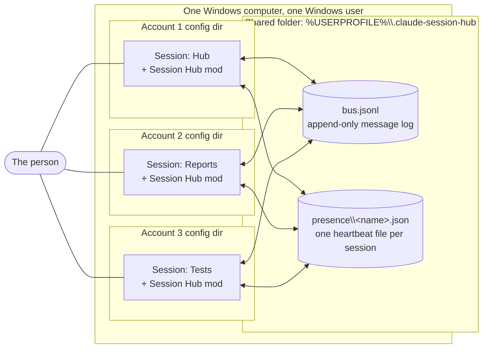
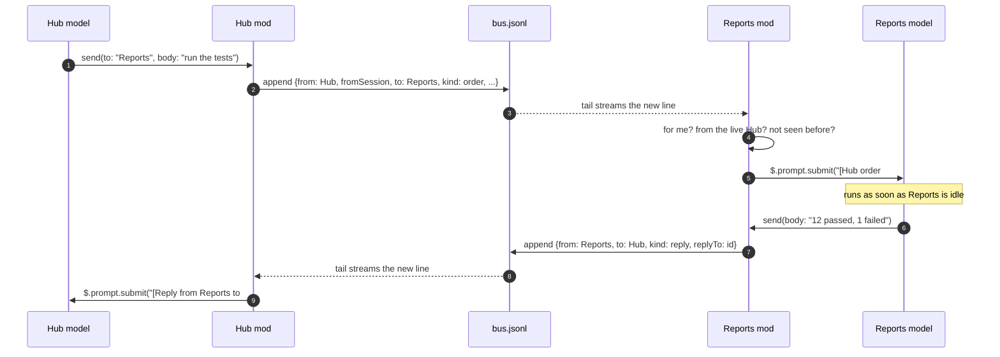
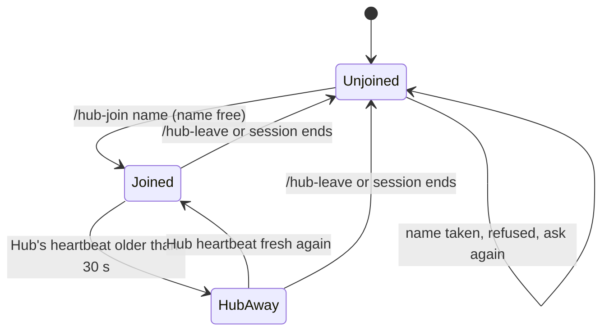

# Architecture: Session Hub — talking between Claude Code sessions

> Status: APPROVED
> Version: v6
> Last updated: 2026-11-04
> PRD: docs/prd.md (built against v4)

## 1. System Context

Everything runs on one Windows computer, under one Windows user. Several Claude Code sessions run
there at once. They may be signed in to different Claude accounts, which means each one reads its
own config folder (`CLAUDE_CONFIG_DIR`). The **Session Hub mod** is installed in every one of those
config folders. All copies of the mod meet in one shared folder that sits outside every config
folder, so every account can reach it.

Diagram type: a context diagram (flowchart with subgraphs), because the point is *who touches what*,
not ordering.

## 2. High-Level Architecture

There is no server. Each session's copy of the mod does four jobs:

1. **Join.** The person runs `/hub-join <name>`. The mod checks the name is free in the presence
   folder (or refuses), **starts listening at the current end of the log first**, then claims the
   name and appends a `join` line ("I'm here"). The Hub learns of a new session by reading that
   line, so it can only send to a session that is already listening.
2. **Send.** The model calls the mod's `send` tool. The mod stamps the sender, the time and an id,
   and appends one line to `bus.jsonl` while holding the bus mutex (ADR-006).
3. **Listen.** A helper process polls `bus.jsonl` about once a second from its own byte offset and
   streams each complete new line to the mod. It never relies on change notifications, so it cannot
   miss a line, and it never hands over a half-written one. The mod keeps only lines addressed to its
   own name or to `*`, and drops its own.
4. **Act.** A valid order from the Hub, or a reply to the Hub, becomes a new prompt in the session
   (`$.prompt.submit`). It starts a turn when the session is idle, or waits its turn if busy.
   Anything else is shown to the person as a notice only.

Joins and leaves are announced on the log. Liveness is kept apart from it: each session rewrites its
own small heartbeat file every 10 seconds, and a session whose heartbeat is over 30 s old counts as
gone even if it never said goodbye. That keeps heartbeats from filling the log forever.

## 3. Components

### Session Hub mod (one copy per account)
- **Responsibility:** Join/leave, send, listen, act, show presence. Same code in every session; the
  role (Hub or worker) depends only on the name it joined with.
- **Inputs:** Slash commands from the person; `send` tool calls from the model; new bus lines from
  the Bus helper; presence files.
- **Outputs:** Bus lines; its own presence file; prompts queued into its session; notices, a status
  line entry and a pane.
- **Dependencies:** Bus helper, shared folder, Claude Code mod engine.
- **Technology:** Claude Code mod (hooks module, TypeScript), see ADR-004, ADR-005.

### Bus helper (`bus.ps1`, shipped inside the mod)
- **Responsibility:** The only code that touches `bus.jsonl`. Three verbs, all per ADR-006
  (built so far: `append` and `tail`, Phase 1; `clear` and following a clear land in F-014, Phase 4):
  `append` (takes the bus mutex, writes one whole line, flushes, releases),
  `clear` (takes the bus mutex, moves the file into `archive\`, starts an empty one) and
  `tail -From <file id>:<byte offset>|end` (polls about once a second, prints only complete
  newline-ended lines, follows a clear into the new file, runs forever). `end` starts at the
  current end of the file, or at 0 if the file does not exist yet.
- **Inputs:** append: `-Path` and `-LineBase64` (base64 of one UTF-8 JSON line, with no LF or CR).
  tail: `-Path` and `-From`. The file id is the NTFS file identity, written in hex as
  `<volume serial>-<index high><index low>`.
- **Outputs:** append writes the line plus a newline (LF) and prints nothing; it exits 0 (ok), 1 (I/O error),
  2 (bad input) or 3 (mutex timeout, nothing written). tail prints each bus line as it is, plus
  `#pos <file id>:<offset>` lines at start and after each batch, so the mod can store where it is.
  Bus lines start with `{`, so `#pos` lines cannot be mistaken for them. If the file id changes or
  the file shrinks below the offset, tail warns on stderr and restarts at 0 (reading the archived
  file first lands in F-014).
- **Dependencies:** Windows PowerShell, which every Windows 11 machine has.
- **Technology:** PowerShell script run by `$.process.run` (append; clear from F-014) and `$.process.spawn`
  (tail); writers serialised by the named mutex `Local\ClaudeSessionHubBus`. See ADR-006
  (supersedes ADR-002). Tests use Pester 6.2 under PowerShell 7; the helper itself runs on
  Windows PowerShell 5.1.

### Shared folder (`%USERPROFILE%\.claude-session-hub\`)
- **Responsibility:** The meeting place. Holds `bus.jsonl`, `presence\` and `archive\` (cleared logs).
- **Inputs / Outputs:** Files only.
- **Dependencies:** None.
- **Technology:** Plain files, see ADR-001 and ADR-003. Path can be changed by a mod option.

### Presence store (`presence\<name>.json`)
- **Responsibility:** Who is alive, and who holds which name. One file per session:
  `{ name, sessionId, account, role, startedAt, lastSeen }`.
- **Technology:** Whole-file writes with `$.fs.write`, reads with `$.fs.list` + `$.fs.read`. See
  ADR-003.

## 4. Data Flow

### Message format

One JSON object per line in `bus.jsonl`:

| Field | Meaning |
|-------|---------|
| `id` | Unique id, made by the sender's mod |
| `ts` | Time sent, ISO 8601 |
| `from` | Sender's session name — stamped by the mod, never taken from the model. A session name is 1 to 32 letters, digits, `_` or `-` |
| `fromSession` | Sender's Claude Code session id — what makes the Hub hard to fake (ADR-005) |
| `to` | A session name, or `*` for every active session |
| `kind` | `order` (Hub only), `reply` (workers, to the Hub), `info` (anything else), `join` and `leave` (presence announcements written by the mod on join and leave; shown to the Hub, never queued as prompts) |
| `replyTo` | The `id` being answered, on a reply |
| `body` | The message text |

So the tuple you asked for, `(from, to, message)`, is `(from, to, body)`, plus the extra fields that
make it safe and traceable.

### Primary flow: the Hub gives an order, a worker replies

Diagram type: sequence diagram, because this is several actors passing messages over time.

### What a session does with each new line

| Line is… | What the mod does |
|----------|-------------------|
| From itself | Ignore |
| Addressed to another name | Ignore |
| Already seen (same `id`) | Ignore |
| `order` to me or `*`, from the live Hub | Queue it as a prompt (acts right away) |
| `order` from anyone else | Notice to the person only. Never queued (US-10) |
| `reply` to me, and I am the Hub | Queue it as a prompt |
| `info` to me or `*` | Notice to the person only |

### Joining and the Hub going away

Diagram type: state diagram, because a session moves between a few clear states.

- **On join**, in this order: (1) check the name is free, (2) start the listener at the log's
  current end, (3) claim the name and start the heartbeat, (4) append the `join` line. The Hub adds
  the session to its list when it reads that line, so anything the Hub sends after that is past the
  worker's starting offset and cannot be missed. A new session never acts on old orders. It keeps its
  file id and offset in `$.state` so a mod reload carries on where it was.
- **Hub away:** a worker keeps doing whatever is already queued, then simply has nothing new to do.
  Status line says `Hub away — waiting`.
- **Clear:** `/hub-clear` (Hub only), under the bus mutex, moves `bus.jsonl` to
  `archive\bus-<UTC timestamp>.jsonl` and starts an empty one. Each listener sees the file id
  change, finishes reading the archived file to its end, then starts the new file from 0, so no
  message sent around a clear is lost (ADR-006).

## 5. Functional Requirements

| ID | Requirement | Source (PRD story) | Priority |
|----|-------------|-------------------|----------|
| FR-001 | `/hub-join <name>` claims a unique name; refuses a name held by a live session and asks for another; starts listening before it announces itself with a `join` line | US-9, US-13 | Must |
| FR-002 | `/hub-leave` releases the name; the name is also released when the session ends or its heartbeat goes stale | US-9 | Must |
| FR-003 | A `send` tool lets the model send `{to, body}`; the mod stamps `id`, `ts`, `from`, `fromSession`, `kind` | US-1, US-2, US-5 | Must |
| FR-004 | Only the session that holds the name `Hub` can send `kind: order`. A worker's `send` always goes to the Hub as a `reply`; it may answer an order (`replyTo` set) or start a new message to the Hub on its own (e.g. "done", "stuck, need input"), so talk runs both ways | US-5, US-10 | Must |
| FR-005 | `to: "*"` reaches every live session except the sender | US-2 | Must |
| FR-006 | Each session reads every new line within 5 s and applies the "What a session does" table | US-3, US-4 | Must |
| FR-007 | A valid Hub order is queued as a prompt with no human check; it runs when the session is idle | US-3, US-11 | Must |
| FR-008 | An order not from the live Hub is shown as a notice and never queued | US-10 | Must |
| FR-009 | A reply to the Hub is queued as a prompt in the Hub | US-5 | Must |
| FR-010 | Each session writes a heartbeat at least every 10 s; a session is alive if its heartbeat is under 30 s old | US-6 | Must |
| FR-011 | The Hub shows a live list of sessions (pane) and a `list_sessions` tool the Hub model can call | US-6 | Must |
| FR-012 | A worker shows `Hub away — waiting` when the Hub's heartbeat is stale, and never drops queued work | US-11 | Must |
| FR-013 | `/hub-history` shows recent messages; the full log stays readable as a plain file | US-7 | Should |
| FR-014 | `/hub-clear` (Hub only) archives the log and starts an empty one, losing no message sent around it | US-12 | Should |
| FR-015 | Each message id is acted on at most once per session, across mod reloads | US-3 | Must |
| FR-016 | Works the same in any account's config folder; shared folder path is a mod option | US-8 | Must |

## 6. Non-Functional Requirements

| ID | Category | Requirement | Notes |
|----|----------|-------------|-------|
| NFR-001 | Performance | A line appended is seen by every listening session within 5 s | The tail checks about once a second |
| NFR-002 | Performance | Presence list is at most 30 s old | 10 s heartbeat, 30 s stale limit |
| NFR-003 | Reliability | No line lost, torn, half-read or missed when several sessions append at once, or around a clear | ADR-006 |
| NFR-004 | Reliability | No message acted on twice; a reload does not replay | Offset + seen ids in `$.state` |
| NFR-005 | Safety | Only the live Hub's orders are acted on; `from` cannot be set by the model | ADR-005. Guards against accidents, not against a hostile program running as the same Windows user |
| NFR-006 | Safety | No secrets on the bus | PRD constraint. The `send` tool description tells the model so |
| NFR-007 | Scalability | Fine up to about 10 sessions and a log of tens of MB | The tail reads only new bytes, so log size does not slow it |
| NFR-008 | Portability | Needs nothing beyond Claude Code and the PowerShell that ships with Windows | |
| NFR-009 | Usability | Normal use (join, send, receive, heartbeat, clear) raises no permission prompt in any session | The model never touches the shared folder with its own tools; only the mod does. Risk A7. Verified by F-001 |

## 7. Technology Decisions

| Concern | Choice | ADR | Rationale |
|---------|--------|-----|-----------|
| Where messages travel | One JSON Lines file in a shared folder outside every config folder | ADR-001 | What you asked for; readable by any account and by a person |
| Writing and reading the file safely | PowerShell helper; named mutex for every write and clear; readers poll by offset and take only complete lines; clear rotates into an archive | ADR-006 | The mod API has no append and caps reads at 4 MiB; mutex avoids torn lines; offset polling cannot miss a line |
| Who is alive, who owns a name | One heartbeat file per session, not lines on the bus | ADR-003 | Keeps the log for real messages only |
| How a message becomes work | `$.prompt.submit` for orders/replies; notices for the rest | ADR-004 | Wakes an idle session, never interrupts a busy one |
| Making the Hub hard to fake | Mod stamps `from` + `fromSession`; orders checked against the live Hub claim | ADR-005 | Sessions act with no human check |
| Packaging | One Claude Code mod, installed in every account's config folder | — | Trivial |

## 8. Open Questions & Risks

| ID | Question / Risk | Impact | Likelihood | Owner | Resolved? |
|----|----------------|--------|------------|-------|-----------|
| A1 | Could Claude Code's built-in session messaging (`SendMessage` / `ListAgents`, `$.session.send`) do this job? | Medium | Low | Muhammed | Yes — it only works between sessions of the same signed-in account. Crossing accounts is the reason this mod exists. Noted as a possible extra path for same-account sessions later |
| A2 | Hub and worker models could loop (order → reply → new order…) and burn tokens | Low | Low | Muhammed | Yes — accepted, no cap. The Hub is the controller: it orders, the worker reports "done", the Hub decides what is next. Workers never give orders, so a loop needs the Hub to keep choosing to send more |
| A7 | The mod reads and writes files outside every session's project folder. If those file calls raised permission prompts, sessions could not act without a human | High | Low | Muhammed | Yes — proven by F-001: the self-test ran in two accounts in the normal permission mode, all 6 steps OK, no permission prompt. Original reasoning: the prompts seen today guard the model's own tools (Read, Bash, Edit), and the `.claude` folder is extra-guarded. The mod's `$.fs` / `$.process` calls run outside the model's tools, and the shared folder is not inside `.claude`. To be proven in the first build item (NFR-009) |
| A3 | Two sessions claim the same free name within the same second | Low | Low | Muhammed | No — second claim re-reads after writing and backs off if it lost |
| A4 | Antivirus or OneDrive locking files in `%USERPROFILE%` slows appends | Low | Low | Muhammed | No — folder is outside OneDrive; append retries |
| A5 | A spawned PowerShell per session costs memory (~60 MB each) | Low | Medium | Muhammed | No — acceptable for ~10 sessions |
| A6 | A worker with a long queue may act on an order minutes later, after the Hub changed its mind | Medium | Low | Muhammed | No — candidate: `/hub-cancel <id>` in a later tranche |

## Version History

| Version | Date | Change | Triggered By | Approved By |
|---------|------|--------|---------------|-------------|
| v1 | 2026-11-04 | Initial draft | — | — |
| v2 | 2026-11-04 | Resolved A1 (built-in messaging is same-account only) and A2 (accepted, no cap). Added risk A7 and NFR-009 (no permission prompts). FR-004: workers may start a message to the Hub, not only answer one | Triage edit | — |
| v3 | 2026-11-04 | Architecture approved; ADR-001 to ADR-005 accepted | Gate approval | Muhammed Ali Khan |
| v4 | 2026-11-04 | Concurrency review: named mutex for writes and clear; readers take only complete lines; clear archives instead of emptying; join order (listen, then announce with a `join` line the Hub reads). ADR-006 supersedes ADR-002 | Triage edit | — |
| v5 | 2026-11-04 | Changes approved | Gate approval | Muhammed Ali Khan |
| v6 | 2026-11-04 | Synced with Phase 1 build: `kind` list adds join/leave; risk A7 resolved by F-001; Bus helper inputs/outputs (`-LineBase64`, exit codes, `#pos` lines, `-From end`, file id format); Pester 6.2; session-name rule (1 to 32 of `A-Z a-z 0-9 _ -`); ADR-003 amended: join/leave have their own kinds; Bus helper marks `clear` and clear-following as F-014 | Triage edit | — |
